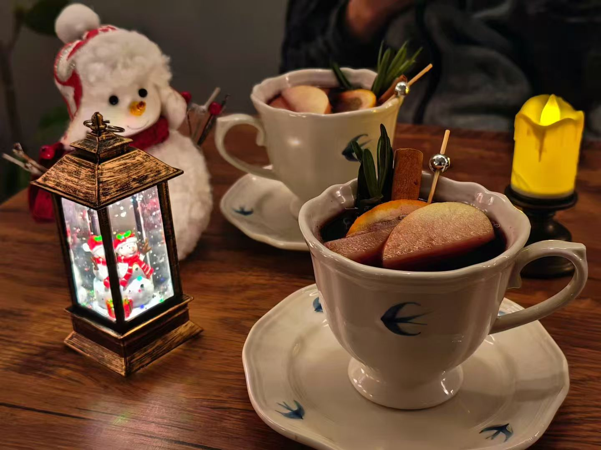
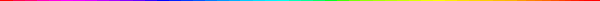
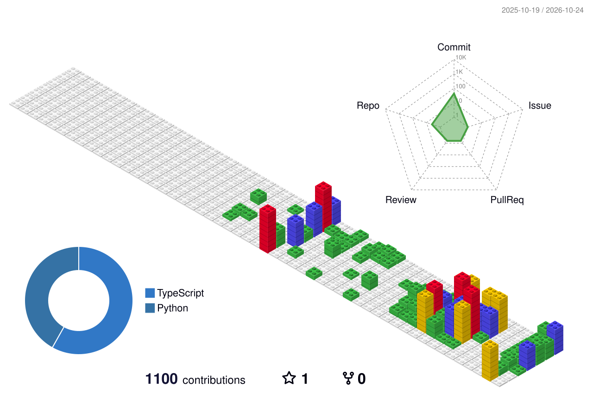
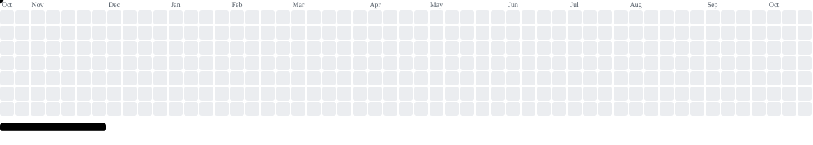

<!-- Layout and coding/developer visuals reused from Peter-JXL/Peter-JXL and sun0225SUN/sun0225SUN. -->

<picture>
  <source media="(prefers-color-scheme: dark)" srcset="./assets/capsule-header-dark.svg">
  
</picture>

<table width="100%">
<tr><td align="left">

## 🙋About Me

<picture>
  <source media="(prefers-color-scheme: dark)" srcset="./assets/coding.gif">
  
</picture>

- 📍 Location: Beijing
- 👤 Identity: Undergraduate, Tech Worker
- 📚 Academic Interests: Statistics, Linguistics, Computer Science, Artificial Intelligence
- ⛰️ Personal Hobbies: Food, Hiking, Mountaineering

&nbsp;

</td></tr>

<tr><td align="left">

## 🌊Words

🟨 Empty your mind.\
🟧 Be formless, shapeless like water.\
🟥 You put water into a cup, it becomes the cup.\
🟩 You put water into a bottle, it becomes the bottle.\
🟪 You put water in a teapot, it becomes the teapot.\
🟫 Water can flow or it can crash.\
🟦 **Be water, my friend.**

&nbsp;

</td></tr>
</table>

 

 

<picture>
  <source media="(prefers-color-scheme: dark)" srcset="./assets/metrics-dark.svg">
  
</picture>
<picture>
  <source media="(prefers-color-scheme: dark)" srcset="./profile-3d-contrib/profile-night-rainbow.svg">
  
</picture>

 

 

<picture>
  <source media="(prefers-color-scheme: dark)" srcset="./assets/snake-dark.svg">
  
</picture>

 

<picture>
  <source media="(prefers-color-scheme: dark)" srcset="./assets/arcade-pacman-dark.svg">
  
</picture>

 

<picture>
  <source media="(prefers-color-scheme: dark)" srcset="./assets/arcade-breakout-dark.svg">
  
</picture>

<picture>
  <source media="(prefers-color-scheme: dark)" srcset="./assets/capsule-footer-dark.svg">
  
</picture>

