<!-- Layout and coding/developer visuals reused from Peter-JXL/Peter-JXL and sun0225SUN/sun0225SUN. -->

<picture>
  <source media="(prefers-color-scheme: dark)" srcset="./assets/capsule-header-dark.svg">
  
</picture>

<picture>
  <source media="(prefers-color-scheme: dark)" srcset="./assets/coding.gif">
  
</picture>

 

Empty your mind.\
Be formless, shapeless like water.\
You put water into a cup, it becomes the cup.\
You put water into a bottle, it becomes the bottle.\
You put water in a teapot, it becomes the teapot.\
Water can flow or it can crash.\
**Be water, my friend.**

 

 

<picture>
  <source media="(prefers-color-scheme: dark)" srcset="./assets/stats-dark.svg">
  
</picture>
<picture>
  <source media="(prefers-color-scheme: dark)" srcset="./assets/languages-dark.svg">
  
</picture>

 

<picture>
  <source media="(prefers-color-scheme: dark)" srcset="./assets/streak-dark.svg">
  
</picture>

 

<picture>
  <source media="(prefers-color-scheme: dark)" srcset="./assets/trophies-dark.svg">
  
</picture>

 

<picture>
  <source media="(prefers-color-scheme: dark)" srcset="./profile-3d-contrib/profile-night-rainbow.svg">
  
</picture>

 

 

<picture>
  <source media="(prefers-color-scheme: dark)" srcset="./assets/snake-dark.svg">
  
</picture>

 

<picture>
  <source media="(prefers-color-scheme: dark)" srcset="./assets/arcade-pacman-dark.svg">
  
</picture>

 

<picture>
  <source media="(prefers-color-scheme: dark)" srcset="./assets/arcade-breakout-dark.svg">
  
</picture>

<picture>
  <source media="(prefers-color-scheme: dark)" srcset="./assets/capsule-footer-dark.svg">
  
</picture>

